<a href="https://beckettclarke.ca">
  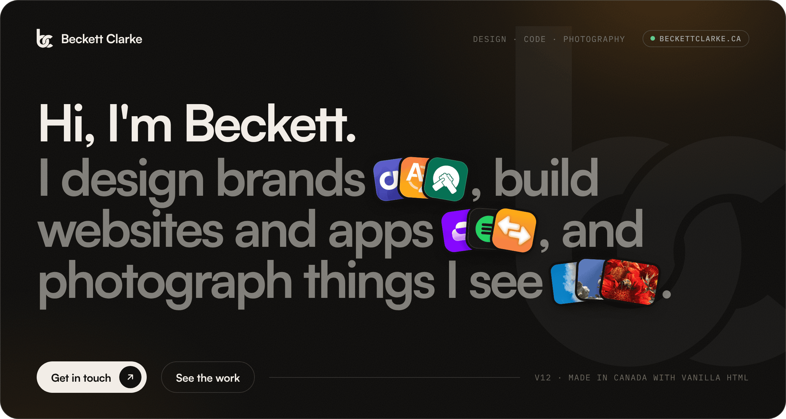
</a>

<p align="center">
  <a href="https://beckettclarke.ca"></a>
  <a href="https://github.com/beckettclarke/website/actions/workflows/static.yml"></a>
  
  
</p>

<p align="center">
  The source for <a href="https://beckettclarke.ca"><b>beckettclarke.ca</b></a>, my portfolio for design, code and photography.<br>
  Hand-written HTML, CSS and JavaScript. No framework, no bundler, no <code>node_modules</code>.
</p>

<br>

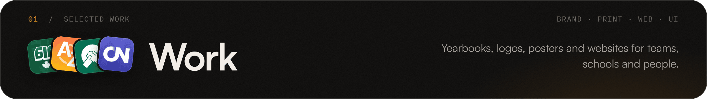

<a href="https://beckettclarke.ca/#work">
  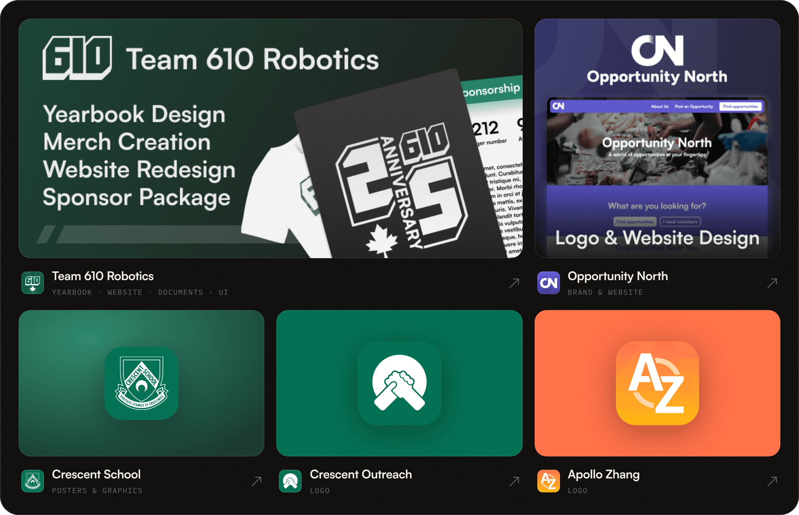
</a>

| | Project | What I made |
|:-:|---|---|
|  | [**Team 610 Robotics**](https://beckettclarke.ca/clients/team610/) | The 25th anniversary yearbook, the sponsorship package sent to partners, merch, a scouting app design used on competition days, and a new website. |
|  | [**Opportunity North**](https://beckettclarke.ca/clients/opportunitynorth/) | Logo, brand and website for a platform that connects volunteers with people who need a hand. |
| 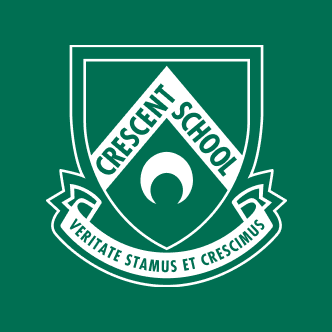 | [**Crescent School**](https://beckettclarke.ca/clients/crescent/) | Posters and graphics for Friday Night Lights and House Day. |
|  | [**Crescent Outreach**](https://beckettclarke.ca/clients/csoutreach/) | Logo. |
|  | [**Apollo Zhang**](https://beckettclarke.ca/clients/apollozhang/) | Logo for Apollo Zhang & AZ Scenes. |

<br>

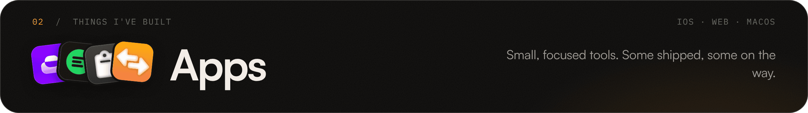

<a href="https://beckettclarke.ca/#apps">
  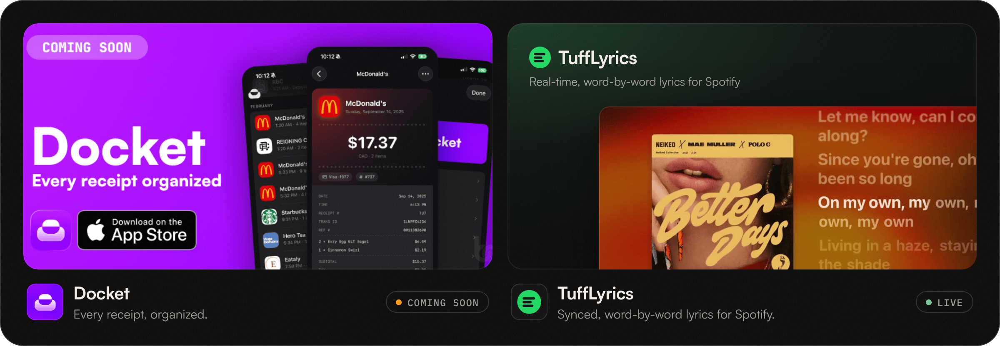
</a>

| | App | | |
|:-:|---|---|:-:|
|  | **Docket** | Every receipt, organized. An iPhone app for receipts. | `Coming soon` |
| 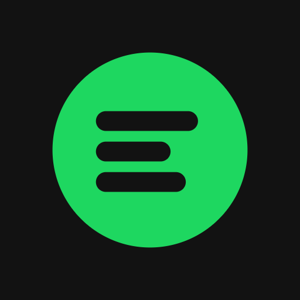 | [**TuffLyrics**](https://tufflyrics.beckettclarke.ca) | Real-time, word-by-word synced lyrics for Spotify. | `Web` |
|  | [**Pastezone**](https://pastezone.beckettclarke.ca) | A scratchpad for text, with Markdown and export. | `Web` |
|  | [**Imagesnap**](https://beckettclarke.github.io/imagesnap) | Convert images between PNG, JPG, ICO, WEBP and GIF in the browser. | `Web` |
|  | [**macOS Icons**](https://beckettclarke.ca/macicons/) | 36 custom app icons for macOS, free to download. | `Free` |

<br>

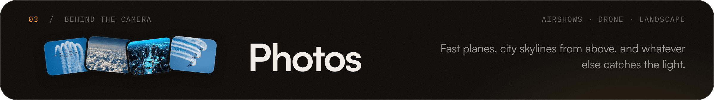

<a href="https://beckettclarke.ca/photography">
  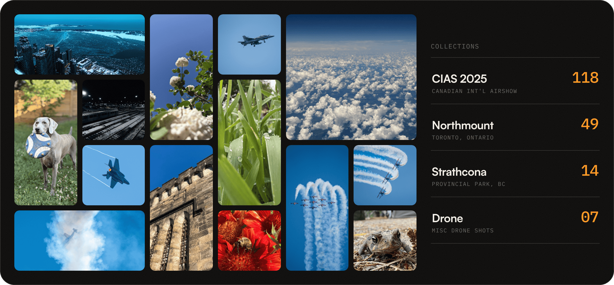
</a>

<p align="center">
  <a href="https://beckettclarke.ca/photography/cias/2025/"><b>CIAS 2025</b></a> &nbsp;·&nbsp;
  <a href="https://beckettclarke.ca/clients/northmount/"><b>Northmount School</b></a> &nbsp;·&nbsp;
  <a href="https://beckettclarke.ca/photography/strathcona/"><b>Strathcona</b></a> &nbsp;·&nbsp;
  <a href="https://beckettclarke.ca/photography/drone/"><b>Drone</b></a>
</p>

<p align="center">
  Full-resolution images live on a separate CDN, so this repo stays light.<br>
  Every photo opens in a keyboard- and swipe-friendly lightbox.
</p>

<br>

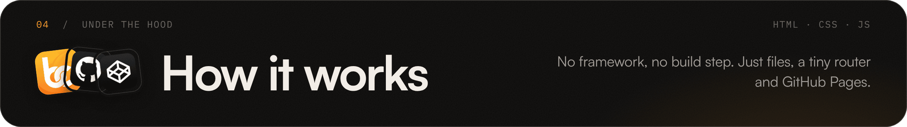

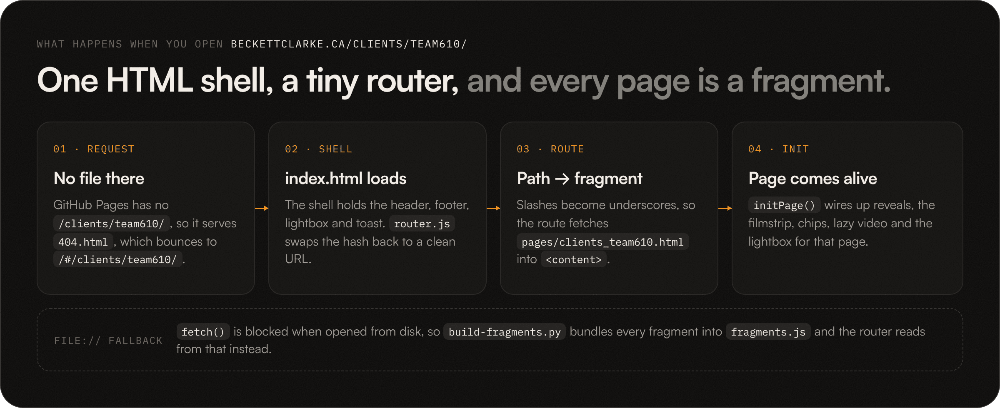

The whole site is a single `index.html` shell. Every page is an HTML **fragment** in `pages/` that `router.js` drops into `<content>`, so moving between pages never does a full reload. GitHub Pages doesn't know about routes like `/clients/team610/`, so `404.html` turns the path into a hash, and the router swaps it straight back to a clean URL with `history.replaceState`.

```text
website/
├── index.html            ← the shell: header, footer, lightbox, toast
├── 404.html              ← turns /any/path into /#/any/path for the router
├── router.js             ← path → pages/<route>.html, transitions, scroll restore
├── scripts.js            ← nav, reveals, filmstrip, chips, lightbox, macOS icon picker
├── flexkit.js / .css     ← tiny helpers: get.id(), log(), attribute layout utilities
├── header.html           ← nav, loaded into <header>
├── footer.html           ← footer, loaded into <footer>
├── pages/                ← one fragment per route
│   ├── home.html
│   ├── clients_team610.html          → /clients/team610/
│   ├── photography_cias_2025.html    → /photography/cias/2025/
│   └── …
├── fragments.js          ← generated bundle of every fragment (for file://)
├── build-fragments.py    ← regenerates fragments.js
├── css/                  ← global, header, home and page styles
├── icons/  res/          ← logos, app icons, bento art, previews
└── .github/workflows/    ← deploys to GitHub Pages on push to main
```

<details>
<summary><b>A few details worth knowing</b></summary>
<br>

- **Routes map to files.** Slashes become underscores, so `/clients/team610/yearbook` loads `pages/clients_team610_yearbook.html`. Anything missing falls back to `pages/notfound.html`.
- **Works straight from disk.** Browsers block `fetch()` on `file://`, so the router falls back to `window.BC_FRAGMENTS` from `fragments.js` and uses hash routing locally.
- **Back and forward remember where you were.** Scroll position is saved in `history.state` and restored on `popstate`.
- **Links like `/#work`** go home first, then scroll to the section once it's loaded.
- **Cloudflare-safe emails.** Cloudflare's email obfuscation doesn't run inside injected HTML, so `scripts.js` decodes those links itself.
- **Respects reduced motion.** Animations, reveals and the film grain calm down under `prefers-reduced-motion`.
- **Cache busting.** CSS and JS are loaded with `?v=12.0.2`. Bump it in `index.html` when shipping changes.
- **Design tokens.** Warm ink `#0d0c0b`, paper `#f2ede6` and one ember accent `#ff9a1f`, set in Satoshi and IBM Plex Mono.

</details>

<br>

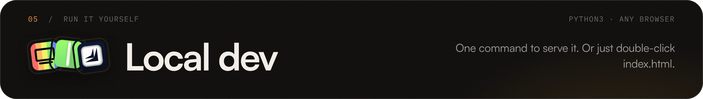

Serve the folder with anything that serves static files:

```bash
git clone https://github.com/beckettclarke/website.git
cd website
python3 -m http.server 8765
# → http://localhost:8765
```

Or just open `index.html` in a browser. It switches to hash routing and reads pages from `fragments.js`.

**Adding a page**

1. Create `pages/<route>.html` with a `<main class="page" data-title="Page title">` root. For `/photos/new/`, that's `pages/photos_new.html`.
2. Link to it with a normal `<a href="/photos/new/">`. The router intercepts the click.
3. Rebuild the offline bundle so it also works from `file://`:

   ```bash
   python3 build-fragments.py
   ```

**Deploying**

Pushing to `main` runs [`.github/workflows/static.yml`](.github/workflows/static.yml), which uploads the repo as-is to GitHub Pages. There's no build step.

<br>

<a href="mailto:hi@beckettclarke.ca">
  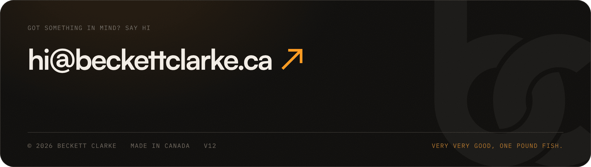
</a>

<p align="center">
  <a href="mailto:hi@beckettclarke.ca"></a>&nbsp;&nbsp;
  <a href="https://instagram.com/beckett_clarke"></a>&nbsp;&nbsp;
  <a href="https://github.com/beckettclarke"></a>&nbsp;&nbsp;
  <a href="https://youtube.com/@beckettclarke"></a>&nbsp;&nbsp;
  <a href="https://codepen.io/beckettclarke">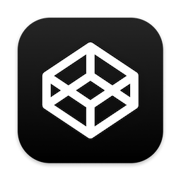</a>
</p>

<p align="center"><sub>© 2026 Beckett Clarke · Made in 🇨🇦 with vanilla HTML</sub></p>
